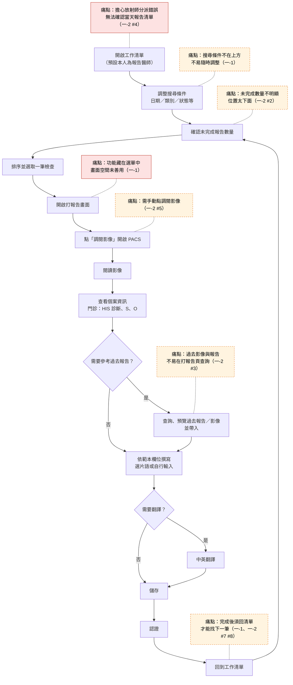

# 影像報告撰寫系統設計（課程案例）

雛型網址：https://cy9299.github.io/report-system-design/

> **標示說明**
> - 出處代號：
>   - **一-1**：訪談一（醫師甲）第一次
>   - **一-2 #n**：訪談一第二次補充第 n 點
>   - **二**：訪談二（放射師團體）
>   - **三**：訪談三（超音波技術員乙）
> - **【推測】**：沒有直接訪談依據的推論。
> - **【暫定】**：雛型中先採用、尚未正式確認的做法。

## 1. 使用者研究

### 醫師人物誌

**醫師甲｜放射科報告醫師**

僅一位受訪者，代表性有限。訪談記錄是訪談者的摘要筆記，不是逐字稿，所以「代表性說法」是依筆記改寫，不是原話。

| 面向 | 內容 | 出處 |
| --- | --- | --- |
| 工作內容 | 撰寫並認證門診放射、健檢胸部 X 光、健檢 2D+3D 乳攝報告 | 一-1 |
| 報告語言 | 以英文撰寫【推測：片語範例皆為英文，且需要中翻英】 | 一-1、一-2 #6 |
| 經驗背景 | 熟悉 A、B 醫院的報告系統，能具體指出別院系統的優點；年資、每日報告量無資料 | 一-1 |
| 目標 | 連續完成多份報告，中途不必回到清單 | 一-1、一-2 #7 #8 |
| 目標 | 隨時掌握各分項還有多少報告未完成 | 一-2 #2 |
| 目標 | 影像、病人資訊、過去報告集中在同一畫面 | 一-1、一-2 #3 #5 |
| 工作習慣 | 大量使用片語，會參考並帶入過去報告 | 一-1、一-2 |
| 工作習慣 | 門診個案會參考 HIS 的診斷、S、O | 一-1 |
| 工作習慣 | 重視步驟少、速度快【推測：減少點擊與自動跳轉的需求反覆出現】 | 一-1、一-2 |
| 挫折 | 功能藏在選單裡，畫面空間沒有善用 | 一-1 |
| 挫折 | 擔心放射師分派報告醫師錯誤 | 一-2 #4 |
| 邊界 | 不希望放射師的功能干擾醫師介面 | 一-2 #1 |

代表性說法（依筆記改寫）：

- 畫面上明明有很多空白，功能卻都藏在選單裡。
- 存完就直接跳下一筆，不要讓我再回清單。

### 醫師任務流程

訪談沒有完整描述現行流程，以下步驟多由需求反推，需要再確認。

- 實線紅框：受訪者明確陳述的痛點
- 虛線橘框：由需求反推的痛點

### 痛點

「對醫師的影響」一欄除特別註明外皆為【推測】。

| 痛點 | 出處 | 對醫師的影響 |
| --- | --- | --- |
| 功能藏在選單中，畫面空間沒有善用（明確陳述） | 一-1 | 常用功能要多一步才找得到，打斷連續作業 |
| 擔心放射師沒有正確分派報告醫師（明確陳述） | 一-2 #4 | 可能漏打或重複打報告，需要自行核對當天清單 |
| 完成一份後必須回清單才能找下一筆（由需求反推） | 一-1、一-2 #7 #8 | 每份報告多出返回、尋找、點選的步驟 |
| 須手動按「調閱影像」（由需求反推） | 一-2 #5 | 每份報告多一次操作，影像與報告分處兩個視窗 |
| 未完成數量不明顯或位置太下面（由需求反推） | 一-2 #2 | 難以掌握剩餘工作量與優先順序 |
| 過去影像與報告不易在打報告頁查詢（由需求反推） | 一-1、一-2 #3 | 比對前次結果需要切換畫面 |

## 2. 需求矛盾與設計決定

「我的設計決定」欄位：

- 標示【暫定】者：雛型目前的做法，尚未經過確認。
- 標示「待決定」者：雛型尚未處理。

| 議題 | 不一致的說法 | 我的設計決定 | 理由 |
| --- | --- | --- | --- |
| 已 DC 醫令的處理 | 放射師：已照的保留並標示 DC，未照的移除（二）；技術員：已 DC 的單都不要出現（三） | 【暫定】採放射師的做法。已照的保留，以左側標記和「醫令已DC」標籤標示；未照的不顯示 | 已照的單可能仍需打報告（例如 R0004），直接隱藏有漏打的風險；醫師是否仍須打報告待確認 |
| 報告醫師的指派方式 | 醫師：由放射師分派，但擔心分派錯誤（一-1、一-2 #4）；放射師：希望依班表自動指派再批次調整（二） | 待決定。雛型只做醫師端，以「報告醫師」篩選預設為登入醫師 | 指派屬於放射師端功能，不在本次範圍 |
| 跳到下一筆的方式 | 第一次：儲存、認證旁放上一筆／下一筆，由使用者自己按（一-1）；第二次：選片語確認後跳（一-2 #7），或儲存後跳（一-2 #8） | 【暫定】儲存或認證後自動跳到下一筆未完成；同時保留上一筆／下一筆按鈕；選片語後不跳轉 | 範本有 2 到 3 個欄位，選一個片語就跳會打斷多欄位撰寫；手動按鈕保留第一次訪談的需求 |
| 「下一筆」的定義 | 訪談未說明是依清單排序、同類別，或只限未完成（一-1、一-2 #7 #8） | 【暫定】依進入打報告畫面時的清單順序與篩選結果，只跳到未完成的報告，到底後繞回前面 | 尊重醫師在清單上設定的篩選與排序 |
| 儲存與認證的差別 | 訪談與模擬資料都有「已完成」與「已認證」，但未定義兩者差別（一-1、模擬資料） | 【暫定】儲存為「已完成」，認證為「已認證」並鎖定，兩者都跳下一筆；「認證」按鈕類型待決定 | 保留先儲存、之後批次認證的可能 |
| 影像預設開或關 | 醫師：打報告時影像直接呈現（一-2 #5）；技術員：F9 開關影像（三） | 【暫定】醫師端預設直接顯示影像區（示意） | 醫師端以醫師需求為準；F9 屬技術員的使用情境 |
| 清單底色的意義 | 醫師：依狀態呈現底色（一-1）；放射師：現行綠色代表已取回影像（二） | 以「報告狀態」決定列底色，狀態色採 B 組；影像狀態另以「未照影像」標籤呈現 | 醫師關心的是報告進度；兩種狀態混用同一底色會互相干擾 |
| 醫師與放射師介面 | 醫師：兩者介面要分開（一-2 #1）；技術員：也有指派、確認報告需求，但未提介面關係（三） | 依設計變數六全面調整：醫師與放射師共用同一個工作清單（見第 4 節） | 原本依醫師需求分開；收到資訊室決議後改為共用 |

## 3. 設計範圍

- **本設計涵蓋**
  - 醫師工作清單：
    - 未完成數量（總數與分項）
    - 搜尋條件、欄位排序
    - 依報告狀態呈現底色與標籤
  - 打報告畫面：
    - 個案資訊，以及上一筆、目前、下一筆的資料
    - 影像顯示區（示意）
    - 依檢查類別顯示的範本欄位與片語
    - 儲存或認證後自動跳到下一筆未完成
  - 迷你設計系統：`tokens.css`、`design-system.md`
- **不涵蓋及原因**
  - **放射師、超音波技術員介面**：本次聚焦報告醫師的核心任務。指派、批次調整、check 註記、退回重打等需求留待後續。
  - **PACS、HIS 串接，以及超音波 SR 數值傳入**：雛型無後端，只以示意區塊標出位置。
  - **翻譯、過去報告與影像查詢、片語設定**：功能需求明確，但做法未確認（見使用者研究的待確認事項），先不設計細節。
  - **超音波報告範本內容**：訪談只提到心超刪除 TR、PR 欄位，欄位結構不足以設計。目前以 Findings、Impression 暫代。

## 4. 設計變數與回應

### 變數二：健檢乳房攝影改為雙人判讀

- **收到的變數**：健檢中心主任來信。依品質管理要求，自下個月起健檢乳房攝影報告改為雙人判讀；兩位醫師各自獨立判讀，BI-RADS 分類不一致時，由第三位醫師裁決後才能認證。
- **影響分析**：
  - **高**：
    - 報告狀態只有三種，不足以表達「待第二判讀」「待裁決」
    - 放射師一筆只能指派一位醫師
    - 同一筆乳攝會出現在兩位醫師的清單，未完成數量要重新定義
    - 認證條件改變
    - 需要獨立判讀（互相隱藏）與裁決畫面
  - **中**：
    - 乳攝範本的 BI-RADS 原本是文字片語，無法自動比對
    - 「目前進度」要新增文字
    - 退回重打後由誰重讀未定義
    - 醫師甲的工作量與角色改變，訪談沒有資料
  - **低**：儲存後自動跳下一筆的機制不變。
- **回應方式：部分調整**（只做最小可行的部分）
  - 乳攝可指派兩位判讀醫師：放射師在「指派為」選擇報告醫師（第一判讀）或第二判讀醫師；同一位醫師不能同時擔任兩個角色。
  - BI-RADS 改為必填的固定選項（0 到 6），兩位都儲存後由系統自動比對。
  - 不一致時，「目前進度」顯示「BI-RADS 不一致，待裁決」；報告狀態維持三種，不新增狀態色。
  - 裁決沿用打報告畫面，只是在範本欄位上方並排顯示兩份判讀；裁決醫師選擇最終 BI-RADS 並撰寫最終報告。
- **理由**：介面不需要大幅調整，只要符合健檢乳房攝影改為雙人判讀的要求即可：兩位醫師各自獨立判讀，BI-RADS 分類不一致時，由第三位醫師裁決後才能認證。
- **【暫定】規則**（卡片未說明，待向健檢中心確認）：
  1. 第二判讀醫師由放射師指派。
  2. 兩位醫師各寫一份完整報告。
  3. 只比對 BI-RADS 類別。
  4. 一致時由第一判讀醫師認證。
  5. 不一致時，兩位判讀醫師以外的任一醫師都可以在打報告畫面裁決，裁決者就是認證醫師。不另外指派裁決醫師，所以待裁決的報告不會出現在第三位醫師的預設清單，需要用搜尋或把「報告醫師」改成「全部」才找得到。
  6. 兩位都完成前，看不到對方的判讀內容。
  7. 新增虛構的「醫師壬」作為第三位醫師，因為模擬資料只有兩位報告醫師。

### 變數六：醫師與放射師共用同一個工作清單

- **收到的變數**：資訊室週會決議。為降低開發與維護成本，醫師與放射師共用同一個工作清單畫面，不另外開發兩套介面。
- **影響分析**：
  - **高**：
    - 與訪談一補充 #1「醫師與放射師的介面分開，不要互相干擾」直接衝突，也與醫師人物誌的「期待與邊界」衝突。
    - 原本的放射師專用畫面要合併；欄位、篩選、指派列都要放進同一個畫面。
  - **中**：
    - 醫師畫面多了勾選、報告格式、操作三欄和指派列，找下一份時要掃描的內容變多。
    - 取消認證與退回重打的入口要重新安排。
  - **低**：打報告畫面只有醫師使用，結構不變。
- **回應方式：全面調整**
  - 醫師與放射師使用同一個工作清單：欄位、篩選條件、指派列、「退回重打」按鈕完全相同。
  - 只有兩處依登入身分不同：
    - 「報告醫師」篩選的預設值：醫師預設為自己，放射師預設為全部。
    - 放射師開啟報告時只能檢視，不能撰寫或認證。
  - 移除上方「依檢查類別顯示的分項數量」與未完成總數的大數字區塊，改成清單上方的一行小提示：「醫師甲未完成 4 份・尚未指派報告醫師 2 筆・未照影像 1 筆・乳攝待指派第二判讀 1 筆」。
- **理由**：配合資訊室降低開發與維護成本的決議，醫師與放射師共用同一個工作清單畫面，不另外開發兩套介面；同時調整頁面設計，讓雙方使用上更直觀、流暢。
- **移除分項數量與總數大區塊的理由**：合併畫面後，分項數量太占版面。醫師一進入系統，可能只想直接看到今天要處理的清單，不會特別在意大區塊顯示還有幾筆沒完成【推測，與訪談一補充 #2 不同，待可用性測試驗證】。
- **與使用者研究的衝突**（保留紀錄，可用於可用性測試觀察）：
  1. 訪談一補充 #1：醫師要求介面分開。
  2. 訪談一補充 #2：醫師要求依報告項目顯示未完成的分項數量，且「位置不要太下面，數量要明顯」；現在分項已移除，總數改為小字提示。
  3. 醫師同樣可以勾選並指派、退回重打，誤操作的風險要在可用性測試中觀察。
- **【暫定】**：醫師也能使用指派與退回重打，因為全面調整要求畫面與按鈕完全相同。
- **給資訊主管的回覆**：

  > 主管您好，為降低開發與維護成本，醫師與放射師將共用同一個工作清單畫面，不另外開發兩套介面。同時我們調整了頁面設計，讓雙方在使用上更直觀、流暢。

## 5. 設計演進

### 第一版

`report-prototype.html`，單頁 HTML，資料存在程式變數中，不需要後端。

- **工作清單**
  - 上方以大字顯示未完成總數，並依檢查類別顯示分項數量；點分項可直接篩選。
  - 搜尋條件放在清單上方，所有欄位可排序。
- **打報告畫面**
  - 一側為影像示意區，另一側依檢查類別顯示範本欄位與片語。
  - 儲存或認證後自動跳到下一筆未完成；全部完成時出現提示。

### 替代方案與選擇理由

**報告狀態色**

比較了三組選項，所有選項的標籤文字對比都在 5.4:1 以上：

| 選項 | 做法 | 主要考量 |
| --- | --- | --- |
| A 延續四色相 | 黃、藍、綠、紅 | 綠色盲下「未完成」與「醫令已DC」幾乎同色；「已完成」底色與選取底色撞色 |
| B 色覺友善色相 | 橘、天藍、藍綠、洋紅紅（Okabe-Ito 調深） | 紅色盲、綠色盲下任兩種狀態都可依顏色區分；藍色盲（極少見）下「已完成」與「已認證」較接近 |
| C 只強調待辦 | 只有未完成有底色與實心標籤 | 任何色覺下都能看出哪些要處理，但「已完成」與「已認證」只能靠圖示區分 |

選擇 **B 組**：以國際通用的色覺友善色盤（Okabe-Ito）為基礎調深，改用橘、天藍、藍綠、洋紅紅。

三組共同的限制是列底色與白底對比只有 1.1 到 1.2:1，所以狀態一律以「圖示＋文字」標示，顏色只做輔助。

**工作清單版面**（第二個版本）

依設計系統、使用相同模擬資料（醫師甲），產生三種設計理念不同的工作清單版面，比較頁為 `layouts.html`。

| 方案 | 設計理念 | 找到下一份要打的報告 | 未完成數量 | 主要缺點 |
| --- | --- | --- | --- | --- |
| A 表格清單 | 所有檢查放在同一張可排序、可篩選的表格，醫師自己掃描、決定下一份 | 點 1 次，需先掃描表格 | 上方總數＋分項 | 未完成與已完成混在同一張表，要靠底色與標籤掃描 |
| B 依類別分欄的卡片 | 每個檢查類別一欄，欄首顯示該類未完成數量 | 點 1 次，需先選類別 | 總數＋每欄欄首 | 看不出跨類別的時間先後；類別多時要橫向捲動 |
| C 待辦佇列 | 系統依檢查時間排序，最上方直接放「下一份」與「開始撰寫」 | 點 1 次，不需掃描與判斷 | 左上大數字＋分項 | 順序由系統決定；查詢、核對需另外的搜尋功能 |

選擇 **A 表格清單**。理由：

- **查詢與核對最方便**：排序與篩選最完整，走查任務 3、4（查 R0004 為何還沒出來、R0009 目前狀態）都需要用到。
- **找下一份的差異不大**：三個方案都只要點 1 次；加上雛型已有「儲存後自動跳下一筆」，A 需要先掃描表格的成本有限。

截圖：

- 方案 A：`screenshots/版面方案A.png`
- 方案 B：`screenshots/版面方案B.png`
- 方案 C：`screenshots/版面方案C.png`

### 啟發式評估與設計變數後的修改

**一致性檢查**（對應 Nielsen 第 4 條「一致性與標準」）

完整的啟發式評估待補。

盤點第一版後發現：

- 30 個寫死的色值、11 種字級、約 19 種間距值
- 18 項不一致，代表性的有：
  - 同一動作「返回工作清單」在兩處使用不同按鈕樣式
  - 上一筆／下一筆同時有卡片與按鈕兩組控制
  - 「已完成」列底色與選取底色無法區分
  - 紅色同時代表「醫令已DC」與錯誤訊息
  - 「醫令已DC」有三種寫法
  - 輸入框框線對比不足 3:1
  - 欄位沒有錯誤狀態

**修改**

依盤點結果建立迷你設計系統，雛型改版為 `index.html`：

- 色值、字級、間距一律使用 tokens 變數。
- 控制項統一 36px 高；按鈕只分主要、次要。
- 狀態標籤改為「SVG 圖示＋文字」；DC 改為左側標記，不當列底色；錯誤訊息改用獨立的危險色。
- 上一筆／下一筆卡片改為只顯示資訊，操作集中在儲存旁的按鈕。
- 返回清單時標示剛才處理的那一筆。
- 欄位全空時，欄位顯示紅框，下方出現錯誤說明。

**已決定**（2026-11-10）：「認證」維持次要按鈕；字級維持 15／13px；頁面維持灰底白卡。

**第二週：任務走查與修改**

依課程的醫師基本操作流程與放射師簡化流程走查（以模擬資料、雛型測試用的身分切換操作）。

| 任務 | 修改前 | 卡住的步驟或缺少的功能 | 修改 | 修改後 |
| --- | --- | --- | --- | --- |
| 醫師 1：今天有幾份、哪些類別 | 勉強 | 未完成數量是所有日期的合計 | 未修改；變數六後改為清單上方一行提示 | 可以（從提示讀出份數；分項改由清單判斷） |
| 醫師 2：依序完成，不回清單 | 可以 | R0004（醫令已DC）的提示讓醫師不知道該不該打 | 提示改為「醫令已DC，但檢查已照影像，此報告仍列在待打清單」 | 可以 |
| 醫師 3：R0004 為何還沒出來 | 勉強 | 看不出原因 | 新增「目前進度」欄，例如「醫令已DC，醫師甲尚未撰寫」 | 可以 |
| 醫師 4：R0009 何時會出來 | 勉強 | 預設只看自己的報告，搜尋單號顯示「沒有符合條件」 | 搜尋單號／身分證號時不受報告醫師篩選限制；目前進度顯示「等待取回影像、尚未指派報告醫師」 | 可以（查得到狀態，沒有預計時間） |
| 醫師 5：醫師丙修改已認證的 R0005 | 不能 | 沒有切換身分、沒有取消認證 | 新增登入身分切換（雛型測試用）；報告醫師本人可取消認證（確認對話框） | 可以 |
| 放射師 1：找出未指派的檢查 | 不能 | 沒有放射師介面 | 新增放射師功能；變數六後與醫師共用工作清單，用「報告醫師＝未指派」篩選 | 可以 |
| 放射師 2：指派 R0006 給醫師甲並確認數量 | 不能 | 同上 | 勾選後以可搜尋的醫師欄位指派，可一次指派多筆 | 可以（醫師甲未完成 4 → 5） |
| 放射師 3：指派沒有影像的 R0009 | 不能 | 同上 | 可先指派；醫師要等影像取回後才能撰寫，進度顯示「等待取回影像」 | 可以 |

走查時另外發現並修正：在搜尋框輸入單號後直接點清單的某一列，第一次點擊沒有反應（搜尋框失去焦點時清單重繪）。

**仍未處理**：醫師基本流程步驟 7「參考過去報告」尚未設計；課堂排定的修改優先順序（待補）。

**依設計變數的修改**：見第 4 節。

- 乳攝雙人判讀：BI-RADS 必填選項、自動比對、並排判讀。
- 共用工作清單：拿掉分項數量與總數大區塊，改成一行提示。

### 可用性測試後的修改

（待補）
